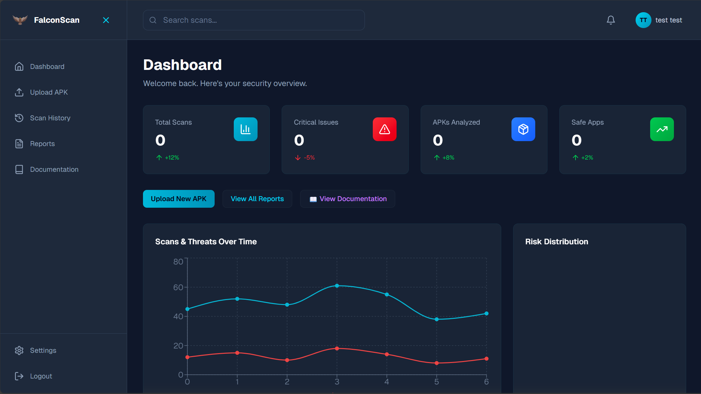
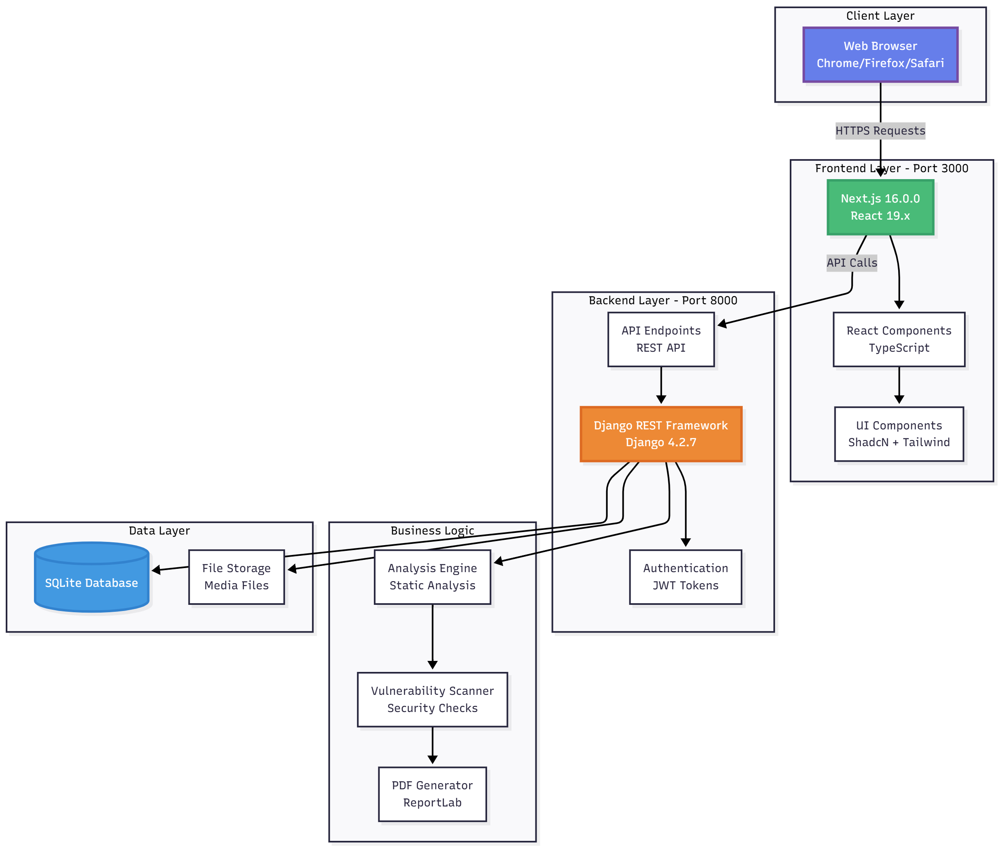
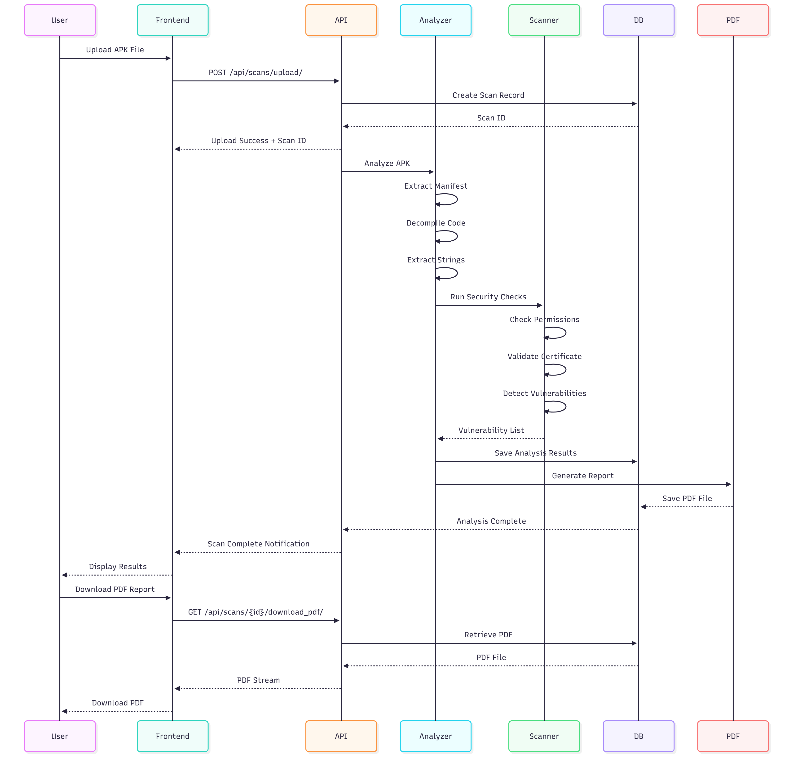
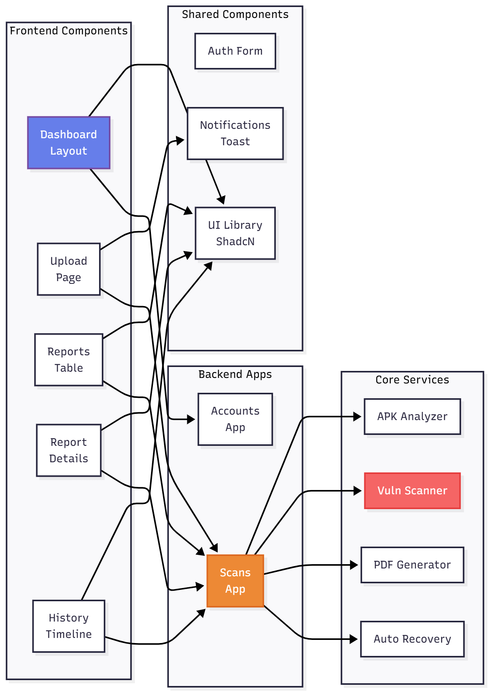

# 🦅 FalconScan - Advanced APK Security Analysis Platform

<div align="center">

[](https://opensource.org/licenses/MIT)
[](https://www.python.org/)
[](https://www.djangoproject.com/)
[](https://nextjs.org/)
[](https://www.typescriptlang.org/)

**A comprehensive cybersecurity platform for analyzing Android APK files, detecting threats, vulnerabilities, and malicious behavior using advanced static analysis and AI-powered intelligence.**



</div>

---

## 📋 Table of Contents

1. [🎯 Overview](#overview)
2. [✨ Features](#features)
3. [🏗️ Architecture](#architecture)
4. [🛠️ Technology Stack](#technology-stack)
5. [📋 Prerequisites](#prerequisites)
6. [🛠️ Installation](#installation)
7. [📖 User Guide](#user-guide)
8. [🤖 AI Analysis](#ai-analysis)
9. [🔒 Security Analysis](#security-analysis)
10. [🔌 API Documentation](#api-documentation)
11. [📁 Directory Structure](#directory-structure)
12. [📄 Pages](#pages)
13. [🌍 Environment Variables](#environment-variables)
14. [🚀 Deployment](#deployment)
15. [🐛 Troubleshooting](#troubleshooting)
16. [📄 License](#license)

---

## 🎯 Overview

> FalconScan is an advanced Android APK security analysis platform for static analysis, vulnerability detection, AI-assisted triage, and professional reporting.

### Key Highlights

| ⚡ Fast Analysis | 🔒 Security Checks | 📊 Professional Reports | 🎨 Modern UI |
|:---:|:---:|:---:|:---:|
| Completes analysis in seconds | Covers secrets, crypto, permissions, network risks, and more | PDF and JSON reporting with remediation guidance | Cybersecurity-themed interface with real-time feedback |

| 🤖 AI Assistance | 📱 APK Focused | 🚀 Live Updates | 🛡️ Production-Ready |
|:---:|:---:|:---:|:---:|
| Optional Gemini-powered analysis and summaries | Built for Android package workflows | Progress tracking and notifications | JWT auth, role-aware dashboard, and deployment guidance |

---

## ✨ Features

- 🔍 **Real-time APK Analysis** - Instant threat detection and vulnerability scanning
- 🛡️ **Advanced Security Checks** - Detect hardcoded secrets, weak crypto, dangerous permissions
- 🤖 **AI Security Intelligence** - On-demand AI analysis with attack chains, severity re-scoring, and code-level fix recommendations
- 📊 **Dynamic Risk Scoring** - Industry-standard CVSS-inspired weighted scoring system
- 📈 **Comprehensive Reporting** - Detailed vulnerability reports with remediation guidance
- 🔐 **Permission Analysis** - Identify dangerous permissions and risky behaviors
- 📉 **Threat Visualization** - Interactive charts and graphs for vulnerability breakdown
- 📜 **PDF Export** - Professional security reports for documentation
- 🔔 **Real-time Notifications** - Stay informed about scan completion and threats
- 👤 **User Management** - Secure JWT authentication and profile management
- 🎨 **Modern UI** - Professional dark cybersecurity theme with glassmorphism effects

## 🛠️ Technology Stack

### Backend
- **Framework**: Django 4.2 + Django REST Framework
- **APK Analysis**: Androguard 4.x for decompilation and static analysis
- **AI Engine**: google-genai 1.0+ for intelligent security reporting
- **Authentication**: JWT (djangorestframework-simplejwt)
- **Database**: SQLite (development) / PostgreSQL (production)
- **Server**: Daphne (ASGI)
- **PDF Generation**: ReportLab
- **API**: RESTful with comprehensive endpoints

### Frontend
- **Framework**: Next.js 16 with TypeScript 5
- **UI Library**: React 19
- **Components**: shadcn/ui + Radix UI
- **Styling**: Tailwind CSS with custom cybersecurity theme
- **Charts**: Recharts for data visualization
- **HTTP Client**: Axios
- **Date Handling**: date-fns

---

## 🏗️ Architecture

### High-Level System Architecture

The application is split into a Django backend for analysis and persistence, and a Next.js frontend for the dashboard, reports, and uploads.



### Data Flow Architecture



### Component Architecture



### Core Modules

- Backend API and analysis engine live under `backend/`
- Frontend dashboard and user flows live under `app/`
- Shared UI, auth, and notification components live under `components/`
- API access and helpers live under `lib/`

---

## 📋 Prerequisites

- Python 3.8 or higher
- Node.js 18 or higher
- npm or pnpm
- Git

---

## 🛠️ Installation

### 1. Clone the repository

```bash
git clone https://github.com/yourusername/falconscan.git
cd falconscan
```

### 2. Backend Setup

```bash
cd backend

# Create virtual environment
python -m venv venv

# Activate virtual environment
# On Windows:
venv\Scripts\activate
# On macOS/Linux:
source venv/bin/activate

# Install dependencies
pip install -r requirements.txt

# Run migrations
python manage.py migrate

# Create superuser (optional)
python manage.py createsuperuser

# Start development server
python manage.py runserver
```

The backend will run at `http://localhost:8000`

---

### 3. Frontend Setup

```bash
# In a new terminal, from project root
pnpm install
# or
npm install

# Copy environment file
cp .env.example .env.local

# Update .env.local with your settings:
# NEXT_PUBLIC_API_URL=http://localhost:8000/api

# Start development server
pnpm dev
# or
npm run dev
```

The frontend will run at `http://localhost:3000`

---

## 📖 User Guide

### Upload an APK for Analysis

1. Navigate to `http://localhost:3000`
2. Register or login to your account
3. Go to **Upload** page
4. Drag & drop or browse for an APK file
5. Enter app name (optional - will use filename if empty)
6. Click **Start Analysis**
7. Wait for analysis to complete (~1.5-2 seconds)
8. View detailed security report

### View Analysis Results

- **Dashboard**: Overview of all scans with statistics
- **Reports**: Detailed vulnerability findings for each scan
- **History**: Timeline of all previous scans
- **Download PDF**: Export professional security reports

### Additional Pages

- **Upload**: Submit APKs for static analysis and scoring
- **Documentation**: Read built-in API and usage help
- **Profile**: Manage your account settings and preferences

---

## 🤖 AI Analysis

FalconScan can generate AI-assisted analysis for completed scans using the configured Gemini model.

### What It Adds

- Attack-chain style summaries
- Severity re-scoring and prioritization
- Remediation recommendations
- Compliance-oriented observations

### Usage

1. Open a completed scan report.
2. Select the **AI** tab.
3. Click **Generate AI Report**.
4. Review the generated findings and recommendations.

### Notes

- AI analysis requires `AI_API_KEY` in the backend environment.
- Model selection and fallback behavior are configured in the backend.


---

## 🔒 Security Analysis

### Vulnerability Detection
- Hardcoded API keys and secrets (AWS, Google, Firebase, GitHub, Stripe, and more)
- Weak cryptographic implementations (DES, ECB, MD5, SHA-1)
- Insecure network configurations (HTTP, cleartext traffic)
- Dangerous permissions usage (CAMERA, LOCATION, SMS, CONTACTS, etc.)
- SQL injection vulnerabilities
- Path traversal issues
- Exported components without permission protection
- Debug certificate in production
- 15+ additional security checks

### Risk Scoring Algorithm

Weighted scoring system based on industry standards:
- **Critical**: 25 points each
- **High**: 15 points each
- **Medium**: 8 points each
- **Low**: 3 points each

Multipliers applied for:
- Dangerous permissions (5+): +20%
- Debuggable flag: +15%
- Cleartext traffic: +15%
- Hardcoded secrets: +15%
- Backup allowed: +10%

### Threat Levels

| Level | Score Range | Color | Action Required |
|-------|------------|-------|-----------------|
| **Critical** | ≥ 80 | 🔴 | Immediate attention required |
| **High** | ≥ 60 | 🟠 | Significant security concerns |
| **Medium** | ≥ 35 | 🟡 | Notable issues requiring review |
| **Low** | ≥ 15 | 🟢 | Minor issues or recommendations |
| **Safe** | < 15 | ✅ | No threats detected |

### Analysis Coverage

- Manifest and permission inspection
- Component exposure and exported surface review
- Certificate and signing checks
- Secret, token, and credential pattern detection
- Network and cleartext traffic review
- Weak crypto and insecure storage checks

---

## API Documentation

### Authentication

```bash
POST /api/accounts/users/register/    # Create account
POST /api/token/                      # Login → returns access + refresh JWT
POST /api/token/refresh/              # Refresh access token
GET  /api/accounts/users/me/          # Current user profile
```

### Scans

```bash
POST   /api/scans/upload/             # Upload APK (multipart/form-data)
GET    /api/scans/                    # List all scans (paginated)
GET    /api/scans/{id}/               # Full scan details + analysis results
GET    /api/scans/{id}/report/        # Security report (JSON)
GET    /api/scans/{id}/download_pdf/  # Download PDF report
POST   /api/scans/{id}/rescan/        # Retry a failed scan
DELETE /api/scans/{id}/               # Delete scan + all associated data
GET    /api/scans/statistics/         # Dashboard stats
POST   /api/scans/ai_report/          # Generate AI security report
POST   /api/scans/cleanup_failed/     # Bulk retry all failed scans
```

All scan endpoints require `Authorization: Bearer <access_token>`.

---

## Directory Structure

```
falconscan/
├── backend/
│   ├── falconscan_backend/
│   │   ├── settings.py               # Django configuration
│   │   ├── urls.py
│   │   └── wsgi.py / asgi.py
│   ├── apps/
│   │   ├── accounts/                 # User management (JWT auth)
│   │   │   ├── models.py
│   │   │   ├── views.py
│   │   │   └── serializers.py
│   │   └── scans/                    # Core scan engine
│   │       ├── models.py             # Scan, Vulnerability, Report models
│   │       ├── analyzer.py           # Androguard APK wrapper
│   │       ├── static_analyzer.py    # String & artifact extraction
│   │       ├── vulnerability_scanner.py  # 15+ security checks
│   │       ├── ai_analyzer.py        # AI security intelligence engine
│   │       ├── pdf_generator.py      # ReportLab PDF builder
│   │       └── views.py              # REST API endpoints
│   └── manage.py
├── app/                              # Next.js app router
│   ├── dashboard/
│   │   ├── upload/                   # APK upload interface
│   │   ├── reports/[id]/             # Detailed scan report viewer
│   │   ├── history/                  # Scan history timeline
│   │   ├── settings/                 # User settings
│   │   └── documentation/           # In-app documentation viewer
│   ├── login/
│   ├── register/
│   └── page.tsx                      # Landing page
├── components/                       # Shared React components
├── lib/
│   └── api.ts                        # Centralised Axios API client
└── public/                           # Static assets
```

---

## Pages

### Public Pages
- `/` - Landing page with features and stats
- `/login` - User login with JWT authentication
- `/register` - New user registration

### Dashboard Pages (Protected)
- `/dashboard` - Overview with statistics and recent scans
- `/dashboard/upload` - Upload APK for scanning
- `/dashboard/history` - View all previous scans
- `/dashboard/reports` - Generate and download detailed reports
- `/dashboard/documentation` - Complete API and usage documentation
- `/dashboard/settings` - User settings and preferences
- `/dashboard/profile` - User profile management

---

## Environment Variables

### Backend (`backend/.env`)

```env
DEBUG=True
DJANGO_SECRET_KEY=your-secret-key-here
ALLOWED_HOSTS=localhost,127.0.0.1
CORS_ALLOWED_ORIGINS=http://localhost:3000
DATABASE_URL=sqlite:///db.sqlite3
AI_API_KEY=your-ai-api-key-here
```

### Frontend (`.env.local`)

```env
NEXT_PUBLIC_API_URL=http://localhost:8000/api
NEXT_PUBLIC_APP_NAME=FalconScan
```

---

## Deployment

### Production Checklist
- [ ] Set `DEBUG=False` in Django settings
- [ ] Generate a new `DJANGO_SECRET_KEY`
- [ ] Switch to PostgreSQL for production
- [ ] Set `ALLOWED_HOSTS` to your production domain
- [ ] Configure HTTPS / TLS termination
- [ ] Set `CORS_ALLOWED_ORIGINS` to the production frontend URL
- [ ] Set `AI_API_KEY` for AI analysis feature
- [ ] Run `python manage.py collectstatic`
- [ ] Set up proper logging and monitoring

---

## Troubleshooting

### Backend won't start

```bash
# Check if port 8000 is in use
lsof -i :8000           # macOS/Linux
netstat -ano | findstr :8000  # Windows
```

### Frontend won't start

```bash
# Clear cache and reinstall
rm -rf node_modules .next
pnpm install
```

### Database issues

```bash
# Reset database (development only!)
python manage.py flush --no-input
python manage.py migrate
```

### Missing Python module

```bash
pip install androguard
pip install -r requirements.txt
```

**CORS errors:** Verify `CORS_ALLOWED_ORIGINS` in `backend/falconscan_backend/settings.py` includes your frontend origin.

---

## 📄 License

MIT — see [LICENSE](LICENSE).
